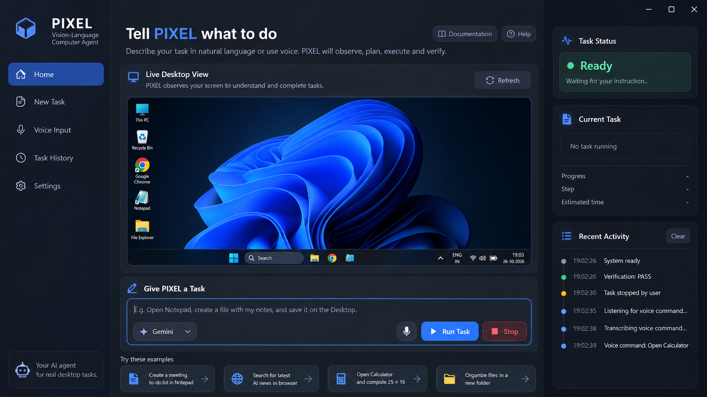
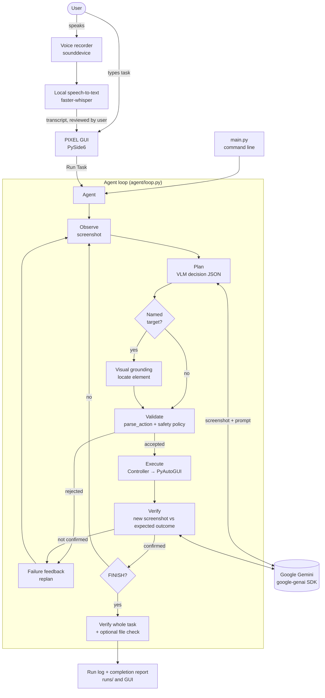

# PIXEL — Your Vision-Language Computer Agent

PIXEL is a Windows desktop agent that carries out tasks you give it in plain
language, typed or spoken. It looks at the screen with a vision-language model
(VLM), chooses **one validated action at a time** (click, type, press a key, ...),
performs it with the mouse and keyboard, and then **checks from a new screenshot
whether the action worked** before continuing.



## Motivation

Most desktop automation is scripted: fixed coordinates or recorded macros that
break when a window moves. PIXEL explores the opposite approach. The model decides
every step from what is currently on screen, and a strict validation and
verification layer around it makes that safe enough to run on a real desktop.
The project was built for the course *25ARE471 — Introduction to Generative AI*.

## Features

| Feature | What it does |
|---|---|
| **Text and voice commands** | Type a task, or speak it: 5 s of audio are transcribed **locally** with faster-whisper; audio is never sent to the cloud. |
| **Vision-language reasoning** | Each step, a screenshot and the task go to the VLM (Google Gemini), which returns a structured JSON decision. |
| **Desktop interaction** | 11 actions: CLICK, DOUBLE_CLICK, TYPE, PRESS, HOTKEY, SCROLL, WAIT, MOVE, DRAG, FINISH, RECOVER. A CLICK can name an element ("the 7 button"); visual grounding locates it. |
| **Safety validation** | Every action passes a strict validator and an execution-time policy: blocked hotkeys (Win+R, Alt+F4, Ctrl+W, ...), blocked shell/registry/destructive text (also when split across several TYPE actions), no screen-corner clicks. The model can never run code. |
| **Execution timeline** | The GUI shows each stage live: observing → planning → validating → executing → verifying → outcome. |
| **Task verification** | Each action's expected outcome is checked visually. FINISH is only a claim; it is accepted only after a check of the whole task, plus an optional deterministic file check. |
| **Recovery** | Failures are classified (rejected action, grounding failure, no decision, execution error, outcome not confirmed, ...) and fed back to the model to replan, with retry limits. |
| **Completion reports** | After each task, a report built only from the run's recorded data: outcome, verification status, steps and timing. |
| **Stop and emergency stop** | Stop/Esc sends no further actions; moving the mouse into a screen corner aborts immediately (PyAutoGUI failsafe). |

## Architecture



Only `agent/controller.py` touches the mouse and keyboard, and only
`agent/gemini_provider.py` imports the Gemini SDK, so the model provider is
swappable. Details: [docs/TECHNICAL_REFERENCE.md](docs/TECHNICAL_REFERENCE.md).

## Technology stack

| Purpose | Library (version pinned in `requirements.txt`) |
|---|---|
| Language | Python 3 (tested with 3.14.7) |
| VLM provider | Google Gemini via `google-genai` 2.25.0 (Interactions API) |
| Mouse/keyboard control, screenshots | `pyautogui` 0.9.54, `pillow` 12.3.0 |
| GUI | `PySide6` 6.11.2 (Qt for Python) |
| Speech-to-text (local) | `faster-whisper` 1.2.1 (model `base`, CPU, int8) |
| Audio recording | `sounddevice` 0.5.6, `scipy` 1.18.1 (WAV writing) |
| Configuration | `python-dotenv` 1.2.3 |
| Tests | `pytest` 9.1.1 |

The default model is `gemini-3.8-flash`; `.env.example` selects `gemini-3.5-flash-lite`.

## Prerequisites and tested environment

* **Windows** (the agent uses Windows APIs for DPI awareness and the Desktop path).
  Tested on Windows 11, 64-bit; other versions have not been tested.
* **Python 3** — tested with Python 3.14.7. Other versions have not been tested.
* A **Google Gemini API key** (free tier available at <https://aistudio.google.com/apikey>).
* A microphone, only for voice input.
* One monitor is recommended; only the primary monitor is used.
* Internet access for the VLM requests and the first faster-whisper model download.

## Installation (Windows)

```powershell
# 1. Get the code
git clone <repository-url>
cd <repository-folder>

# 2. Create and activate a virtual environment
py -3 -m venv .venv
.\.venv\Scripts\Activate.ps1
#    If activation is blocked: Set-ExecutionPolicy -Scope CurrentUser RemoteSigned
#    (or skip activation and call .\.venv\Scripts\python.exe directly)

# 3. Install the dependencies (exact versions from requirements.txt)
python -m pip install --upgrade pip
python -m pip install -r requirements.txt

# 4. Create your local configuration (see next section)
copy .env.example .env

# 5. Check the environment (sends no VLM request)
python main.py --check
```

## Configuring the Gemini API key safely

1. Create a key at <https://aistudio.google.com/apikey>.
2. Open your local `.env` (created from `.env.example` above) and set:
   ```
   GEMINI_API_KEY=your-key-here
   ```
   Alternatively, set `GEMINI_API_KEY` as a user environment variable; `.env`
   does not override variables that are already set.
3. Run `python main.py --check`. The VLM line should report `key=set`.

`.env` is listed in `.gitignore` and must **never** be committed or shared. If a
key is ever exposed, revoke it in Google AI Studio and create a new one.

Other settings in `.env`: `VLM_PROVIDER` (`gemini`), `VLM_MODEL`,
`GEMINI_THINKING_LEVEL` (`minimal` | `low` | `medium` | `high`) and `VLM_TIMEOUT`
(seconds). Agent limits and timings are in `config.py`.

## Launching PIXEL

```powershell
python -m gui.app
```

An acknowledgement popup appears once at startup. Close it to use the main window.

Command-line use without the GUI:

```powershell
python main.py "Open Calculator" --dry-run   # one decision, validated and logged, no input sent
python main.py "Open Calculator"             # real run (moves the mouse and types!)
python main.py --demo calculator             # built-in demo with a verified result
```

## Usage

1. Close windows that contain private information: **each step sends a
   screenshot of your primary screen to Google's Gemini API.**
2. Type a task in **Give PIXEL a Task**, or press the microphone and speak for
   5 seconds. Review the transcript.
3. Press **Run Task** (or Enter). Keep your hands off the mouse and keyboard
   while the agent works, and watch the execution timeline.
4. Press **Stop** (or Esc) to stop after the current step. For an immediate
   stop, move the mouse into any screen corner.
5. When the task ends, open **Last report** to see the outcome and whether it was verified.

Good first tasks (these are the built-in demos):

* `Open Calculator and calculate 25 multiplied by 16.`
* `Open Chrome and search for ROS2 Humble.`
* `Open Windows Notepad, write a short list of three robotics technologies (one per line), and save it as robotics_list.txt on the Desktop.`

Start with `--dry-run` from the command line to see what the model would do
without sending any input. Each run is logged to `runs/<timestamp>_<task>/`
(step log, screenshots, summary). That folder contains raw screenshots of your
desktop and is excluded from Git.

## Testing

The automated test suite is not included in this public repository.

```powershell
# Offline control-logic benchmark (scripted model, mocked input)
.\.venv\Scripts\python.exe eval\offline_benchmark.py --out docs\evaluation
```

### Results

There are three kinds of results. They are **not** interchangeable.

**1. Automated test suite (mocked; not included in this repository).** Run on
2026-10-28 on Windows 11 with Python 3.14.7: **659 passed, 1 xfailed, 0 failed**, 380 subtests passed
(about 3 minutes). The xfail is intentional and documents that `parse_action()`
checks one action at a time; a blocked word split over two TYPE actions is
instead stopped at execution time, which a separate test verifies. The one
warning is a `DeprecationWarning` from inside the `google-genai` package. These
tests use mocks only and do not measure real task success.

**2. Offline control-logic benchmark (simulated).** The real agent loop,
validator, safety policy and controller run against a *scripted* model with
mocked input. Last recorded run (2026-10-22, `docs/evaluation/`): 60 trials, all
met their expectation — 20 safety-bypass attempts with 0 violations, 10
legitimate inputs with 0 false-positive blocks, 20 Stop trials with 0 actions
sent after Stop, and 10 recovery scenarios that all ended as expected. This
measures control logic only; it says **nothing about model accuracy or real
task success**. Report: [docs/PIXEL_EVALUATION_RESULTS.md](docs/PIXEL_EVALUATION_RESULTS.md).

**3. Real-desktop runs (not a controlled evaluation).** The demo tasks were run
on a real Windows desktop during development: 29 logged runs between 2026-09-24
and 2026-10-08 — 14 succeeded, 13 failed, 2 were interrupted. They span several
code versions, all before the safety hardening. A formal real-desktop evaluation
protocol and harness are prepared in `eval/`, but **no formal trials have been
run yet**, so there is no measured success rate.

## Limitations and known issues

* **Windows only**, primary monitor only; typing is limited to plain ASCII,
  at most 200 characters per TYPE action.
* **Privacy:** screenshots of the primary screen are sent to Google's Gemini API
  (requests use `store=False`). Do not use PIXEL with sensitive content on screen.
* **Visual verification can be wrong:** a small or fast model may misread the screen.
  GUI-only tasks have no deterministic check.
* **Real-world success rate is unmeasured** (see *Results*).
* The safety policy is a **blocklist, not a sandbox**. Clipboard paste content is
  not inspected; the word "terminal" is blocked in any typed text; closing tabs
  with Ctrl+W is always blocked.
* Stop cannot interrupt a model request already in progress (up to `VLM_TIMEOUT`)
  or an input action already running; it prevents every later action.
* Voice input records a fixed 5 seconds, and the transcript can contain errors.
* Websites change (pop-ups, consent pages); the model has to handle them on its own.
* The agent's own window can be visible to the model.

## Screenshots and demo video

* Main window: `docs/images/pixel-home.png` (shown above).
* *Execution timeline screenshot — to be added.*
* *Completion report screenshot — to be added.*
* *Demo video — to be added.*

## Contributing

Contributions are welcome. See [CONTRIBUTING.md](CONTRIBUTING.md) for setup,
coding rules (for example, only the controller may send input, and model
output is never executed) and the pull-request process. Report security issues
privately as described in [SECURITY.md](SECURITY.md).

## Responsible use

PIXEL operates your real mouse and keyboard and sends screenshots to a cloud model.

* Use it only on computers and accounts you own or are authorised to automate.
* Watch it while it runs, and keep the emergency stop (mouse to a corner) in mind.
* Do not use it with banking, health or other sensitive data on screen, and do
  not use it to send messages or make purchases without supervision.
* Do not use it to bypass security controls, CAPTCHAs or the terms of service of
  websites and applications.
* Review a voice transcript before running it.

## Acknowledgement

This project was developed for the course **25ARE471 — Introduction to Generative
AI** (2026). I sincerely thank **Dr. Rakeshkumar Sidharthan**, Department of
Mechanical Engineering, Amrita School of Engineering, Coimbatore, for the
guidance and support throughout this project.

## License

Released under the [MIT License](LICENSE). Copyright (c) 2026 Sreekeerthi M.

Third-party dependencies are installed from PyPI and keep their own licenses
(MIT, BSD, Apache-2.0 and MIT-CMU; PySide6 is LGPL-3.0). Google Gemini is used
under Google's API terms of service.
